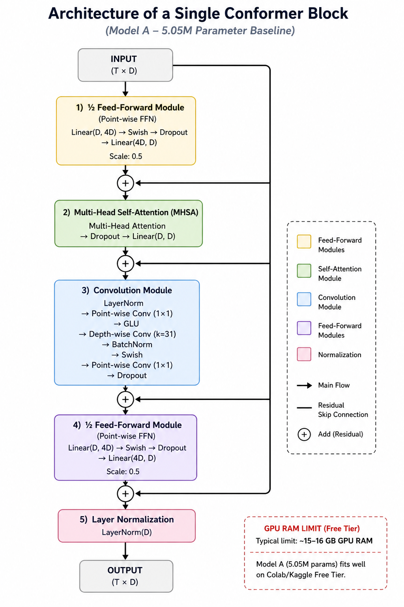
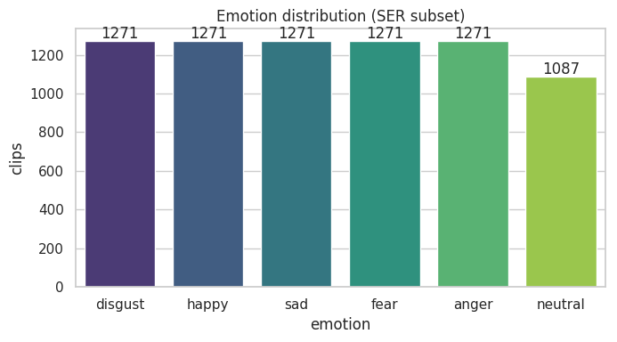
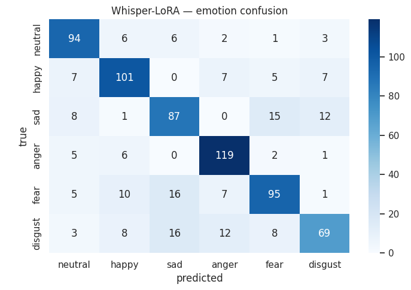
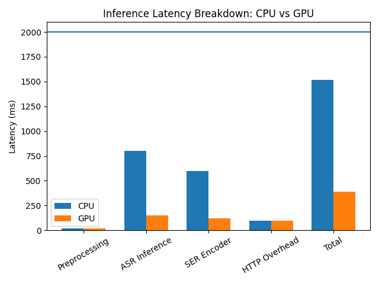

# Spell Caster: dual-task ASR and speech-emotion recognition

I built the speech half of Spell Caster, a voice-controlled spellcasting prototype. The
player speaks a spell name, the pipeline transcribes the word and classifies the emotion
behind it, and the game reacts to both. This repository holds the training notebook, the
inference server, the report and the figures.

| Result | Value | Context |
| --- | --- | --- |
| Emotion F1 (macro) | 0.754 | Whisper-Small with a LoRA-tuned emotion head |
| WER | 0.0015 | Whisper-Small, stock transcription weights |
| WER | 0.113 | From-scratch Conformer, LibriSpeech |
| Latency | 19.3 ms | Conformer, batch size one, ONNX INT8 on CPU |
| End-to-end latency | under 2 s | Full API call on a laptop CPU |



## Problem

Voice control in games is usually a menu shortcut. Here the spell name *and* the emotion
behind it both matter, which means running transcription and affect classification on the
same short, noisy, microphone utterance, on a laptop CPU, in under two seconds.

I compared two models:

- **Model A, Conformer from scratch.** Lightweight, 4x downsampling, CTC head for ASR and
  an attention-pooling head for SER. Exported to ONNX INT8 for cheap CPU inference.
- **Model B, Whisper-Small.** Stock Whisper for transcription, plus LoRA adapters and a
  custom pooling head for emotion.

I trained both tasks together with Kendall's uncertainty weighting, so the two losses do not
need hand-tuned scales. The final server uses stock Whisper for ASR and the LoRA-tuned
encoder for emotion, which is why the shipped WER is 0.0015 rather than the Conformer's
0.113.

## Results







The Conformer is not the better transcriber. It is the cheaper one, and on a CPU that is
the trade that mattered: 19.3 ms per utterance after INT8 export.

## Repository layout

```text
notebooks/spellengine-dual-task-asr-ser.ipynb   training, evaluation and ONNX export
src/server.py                                   FastAPI inference server
assets/                                         the four figures used below
data/README.md                                  CREMA-D and LibriSpeech sources
```

Commit dates reflect when the work was done. I reconstructed the history from the Kaggle
exports, the server source and the report, because the project was written in notebooks and
never tracked in git.

## The server

`src/server.py` exposes one endpoint:

```text
POST /cast_spell   (multipart audio file, 16 kHz mono wav)
-> {"spoken_text": "fireball", "emotion": "anger", "confidence": 0.83}
```

It resamples to 16 kHz, normalises the peak, runs stock Whisper for ASR and the LoRA-tuned
Whisper encoder plus a small classification head for emotion, then falls back to `neutral`
when the emotion confidence is below 0.35.

```bash
pip install -r requirements.txt
python src/server.py          # uvicorn on 127.0.0.1:8000
```

## Model weights

The merged Whisper-LoRA checkpoint and the emotion head (`exports/whisper_lora_merged/`,
about 570 MB) are not committed here. The export cell at the end of the notebook
regenerates them from `openai/whisper-small` and the CREMA-D training run. If you need the
trained weights for a demo, open an issue.

## Team and context

This was a course project for the Natural Language Processing module (ESI-SBA, 2025/2026,
taught by R. Bousmaha).

I built the ASR and SER pipeline, the training notebook, the ONNX export and the FastAPI
server. A teammate built the Unity game and its C# state machines, and we did the
integration together. The Unity sources are not published here.

More about this project on my portfolio:
https://safouane-medjahri.vercel.app/projects/spell-caster
